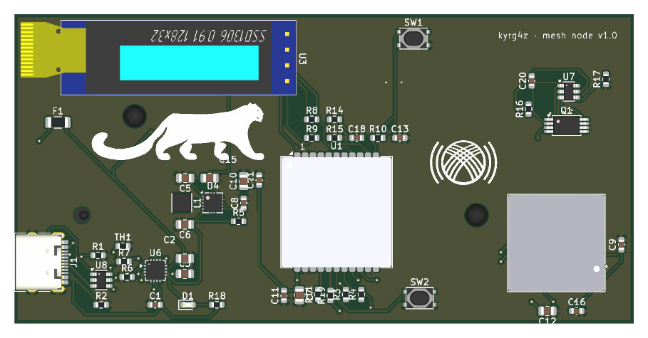
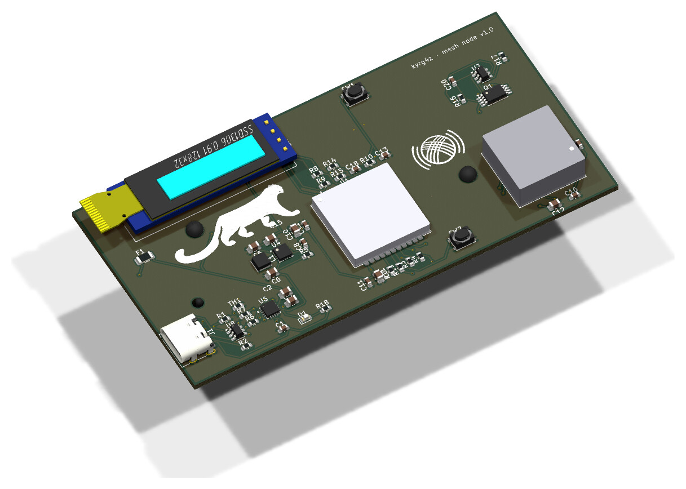
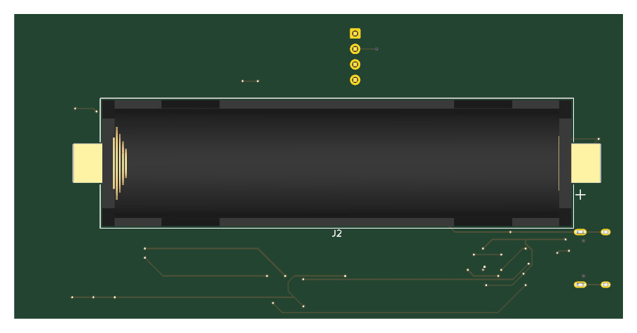
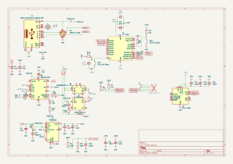
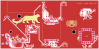
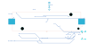

# Custom Meshtastic/Reticulum Node
 
> *Long-range messaging when there's no signal.*

#### Designed by [kyrg4z](https://github.com/kyrg4z)

A custom Meshtastic compatible LoRa communication device that is designed for off-grid messaging in areas where cellular/internet aren't available such as hiking trails, mountains, and forests. This device provides interface for phones to be able to send messages through long range radio through a decentralized mesh network.  

> [!NOTE]
> Read about progress status in JOURNAL.md

### Project Overview
 
A handheld LoRa mesh node built around the Heltec HT-CT62 module (ESP32-C3 + Semtech SX1262), with GPS, a small OLED status display, and a single 18650 cell with USB-C charging and full battery protection. The phone connects over Bluetooth and the node relays messages over 915 MHz LoRa to other nodes in the mesh.

## Story Behind It 

On a chill summer day, while biking in the forest, I tried messaging my friend, but the message didn't go through simply because the cellular signal was too weak there. 
That day I decided to build something of my own, so meeting and sharing location in remote locations would be easier. 
While researching, I learned about LoRa and Meshtastic as well as Ham Radio. I thought Meshtastic would be better for my purposes, so I went with it. Since I wanted to learn PCB design and build something cool, instead of buying a Heltec, Lylygo or SenseCap, I chose to create it myself. I wanted to know how it works and how to mess with it. This project is the result and being hoenst it was quite fun. 
Along the way, I learned how LoRa works(DefCon talks were amazing), how to do PCB design, about ESD protection, and the GNSS system. Probably the hardest part was reading the datasheets and fixing the schematic. 

### The Repository Contains
 
- KiCad schematic and PCB layout
- Gerber, BOM, and centroid files for fabrication and assembly
- Bill of Materials (on-board parts + additional parts)
- Schematic and PCB renders
- Hack Club journal ([JOURNAL.md](JOURNAL.md))

### Hardware
- **MCU + Radio:** Heltec HT-CT62 — ESP32-C3 (RISC-V) + SX1262 LoRa, 902–928 MHz, Wi-Fi/BLE
- **Antennas:** Two onboard IPEX1.0 (U.FL) sockets — LoRa (915 MHz whip via SMA pigtail) and 2.4 GHz (flex antenna for BLE)
- **GNSS:** u-blox SAM-M10Q with built-in patch antenna (UART)
- **Display:** 0.91" 128×32 SSD1306 OLED (I2C)
- **Battery:** 1× 18650 Li-ion in a Keystone 1042 holder
- **Charging:** TI BQ24074 USB charger with power-path management
- **Protection:** DW01A + SI6968BEDQ dual-MOSFET cell protection, 1.5 A resettable PTC fuse
- **Regulation:** TI TPS63001 buck-boost → 3.3 V (stays regulated across the full battery range)
- **USB:** USB-C (USB 2.0) wired directly to the ESP32-C3's native USB, USBLC6-2SC6 ESD protection
- **Battery monitoring:** Voltage divider to an ADC pin
- **Controls/Status:** Reset + Boot buttons, charge-status LED

### PCB Design
 
- 2-layer PCB, 50 × 100 mm
- 0603 passives, 0805 for bulk capacitors
- ENIG surface finish
- Fabricated and assembled by PCBWay (OLED hand-soldered)

No enclosure is part of this submission. The board is meant to be tested bare first, and a case may come in a later revision.

## Firmware
 
- Meshtastic
- Flashed over USB-C
- Planning to implement Reticulum support  
- Status: not yet flashed (waiting on boards)

## 3D Model

Full board assembly with every component: [PRODUCTION/PCB.step](PRODUCTION/PCB.step)

| Top | Bottom |
| :---: | :---: |
|  |  |

> [!NOTE]
> U1 (HT-CT62), U2 (SAM-M10Q) and the OLED module (U3) are dimensioned models generated with CadQuery, since no vendor STEP was available.

## Preview

Interactive KiCad viewer powered by [KiCanvas](https://kicanvas.org):

- **[Open schematic in KiCanvas](https://kicanvas.org/?github=https%3A%2F%2Fgithub.com%2Fkyrg4z%2Fcustom-meshtastic-node%2Fblob%2Fmain%2FPCB%2FPCB.kicad_sch)**
- **[Open PCB layout in KiCanvas](https://kicanvas.org/?github=https%3A%2F%2Fgithub.com%2Fkyrg4z%2Fcustom-meshtastic-node%2Fblob%2Fmain%2FPCB%2FPCB.kicad_pcb)** 

### Schematic 

### PCB snapshot

| Front | Back |
| :---: | :---: |
|  |  |

## Bill Of Materials:

### PCB (assembled by PCBWay):
 
| #  | Reference | Qty | Manufacturer | Manufacturer Part # | Value | Footprint |
| --- | --- | --- | --- | --- | --- | --- |
| 1  | C1 | 1 | Murata Electronics | GRT188R61H105KE13D | 1uF | Capacitor_SMD:C_0603_1608Metric |
| 2  | C2,C3,C5,C6,C7,C10,C12,C15 | 8 | Cal-Chip Electronics, Inc. | GMC21X7R106K25NT | 10uF | Capacitor_SMD:C_0805_2012Metric |
| 3  | C8,C9,C11,C16,C18,C20,C21 | 7 | Murata Electronics | GCJ188R71E104KA12D | 100nF | Capacitor_SMD:C_0603_1608Metric |
| 4  | C13 | 1 | YAGEO | CC0603KRX5R8BB225 | 2.2uF | Capacitor_SMD:C_0603_1608Metric |
| 5  | D1 | 1 | Lite-On Inc. | LTST-C191KRKT | CHG | LED_SMD:LED_0603_1608Metric |
| 6  | F1 | 1 | Littelfuse Inc. | 1206L150SLYR | 1.5A PTC | Fuse:Fuse_1206_3216Metric |
| 7  | J1 | 1 | Korean Hroparts Elec | TYPE-C-31-M-12 | USB-C | Connector_USB:USB_C_Receptacle_HRO_TYPE-C-31-M-12 |
| 8  | J2 | 1 | Keystone Electronics | 1042 | 18650 | Battery:BatteryHolder_Keystone_1042_1x18650 |
| 9  | L1 | 1 | Bourns Inc. | SRN3015-2R2M | 2.2uH | Inductor_SMD:L_Taiyo-Yuden_NR-30xx |
| 10 | Q1 | 1 | Vishay Siliconix | SI6968BEDQ-T1-GE3 | SI6968BEDQ | Package_SO:TSSOP-8_4.4x3mm_P0.65mm |
| 11 | R1,R2 | 2 | Bourns Inc. | CR0603-FX-5101ELF | 5.1k | Resistor_SMD:R_0603_1608Metric |
| 12 | R3,R4 | 2 | YAGEO | RC0603FR-0722RL | 22 | Resistor_SMD:R_0603_1608Metric |
| 13 | R5 | 1 | YAGEO | RC0603FR-07100RL | 100 | Resistor_SMD:R_0603_1608Metric |
| 14 | R6 | 1 | YAGEO | RC0603FR-073KL | 3k | Resistor_SMD:R_0603_1608Metric |
| 15 | R7 | 1 | YAGEO | RC0603FR-073K09L | 3.09k | Resistor_SMD:R_0603_1608Metric |
| 16 | R8,R9 | 2 | YAGEO | RC0603FR-074K7L | 4.7k | Resistor_SMD:R_0603_1608Metric |
| 17 | R10,R11,R19,TH1 | 4 | YAGEO | AR0603FR-0710KL | 10k | Resistor_SMD:R_0603_1608Metric |
| 18 | R14,R15 | 2 | YAGEO | RC0603FR-07100KL | 100k | Resistor_SMD:R_0603_1608Metric |
| 19 | R16 | 1 | YAGEO | RC0603FR-07470RL | 470 | Resistor_SMD:R_0603_1608Metric |
| 20 | R17,R18 | 2 | YAGEO | RC0603FR-071KL | 1k | Resistor_SMD:R_0603_1608Metric |
| 21 | SW1,SW2 | 2 | C&K | PTS810SJS250SMTR LFS | Reset / Boot | Button_Switch_SMD:SW_SPST_PTS810 |
| 22 | U1 | 1 | Heltec Automation | HT-CT62 (902–928 MHz) | HT-CT62 | RF_Module:Heltec_HT-CT62 |
| 23 | U2 | 1 | u-blox | SAM-M10Q-00B | SAM-M10Q | RF_GPS:ublox_SAM-M8Q |
| 24 | U4 | 1 | Texas Instruments | TPS63001DRCR | TPS63001 | Package_SON:Texas_DRC0010J_ThermalVias |
| 25 | U6 | 1 | Texas Instruments | BQ24074RGTR | BQ24074 | Package_DFN_QFN:VQFN-16-1EP_3x3mm_P0.5mm_EP1.6x1.6mm |
| 26 | U7 | 1 | Shenzhen Slkormicro | DW01A | DW01A | Package_TO_SOT_SMD:SOT-23-6 |
| 27 | U8 | 1 | STMicroelectronics | USBLC6-2SC6 | USBLC6-2SC6 | Package_TO_SOT_SMD:SOT-23-6 |

### Additional Parts (per 2 nodes):
 
| Part / Item | Category | Qty | Price (1 item) | Line total | Provider | Link |
| --- | --- | --- | --- | --- | --- | --- |
| **Custom PCB (fab + assembly, 2 assembled of 5)** | PCB | 2 | - | $79.34 USD + parts quote | PCBWay | - |
| **ER-OLEDM0.91-1B-I2C 0.91" OLED** | Display | 3 | $2.80 USD | $8.40 USD | BuyDisplay | [Link](https://www.buydisplay.com/i2c-blue-0-91-inch-oled-display-module-128x32-arduino-raspberry-pi) |
| **Pulse W9015M U.FL → SMA bulkhead pigtail** | LoRa antenna cable | 2 | $7.53 CAD | $15.06 CAD | Digi-Key | [Link](https://www.digikey.ca/en/products/detail/pulse-electronics/W9015M/2267912) |
| **Abracon AEACAC054010-S915 915 MHz whip** | LoRa antenna | 2 | $10.40 CAD | $20.80 CAD | Digi-Key | [Link](https://www.digikey.ca/en/products/detail/abracon-llc/AEACAC054010-S915/9962429) |
| **Ezurio 001-0014 2.4 GHz FlexPIFA (U.FL)** | BLE antenna | 2 | $7.38 CAD | $14.76 CAD | Digi-Key | [Link](https://www.digikey.ca/en/products/detail/ezurio/001-0014/4732758) |
| **18650 Li-ion cell** | Battery | 2 | - | already owned | - | - |
| — | | | | | | |

 

## Assembly Instructions
 
### PCB:
 
The board is fabricated and assembled by PCBWay. U3 (OLED) is marked DNP and is soldered by hand.

1. Check the GND / VCC / SCL / SDA labels on the OLED against the board silkscreen, then solder its 4-pin header into U3.
2. Plug the U.FL end of the SMA pigtail into the **LoRa** socket on the HT-CT62 and screw on the 915 MHz whip.
3. Plug the 2.4 GHz flex antenna into the **2.4G** socket on the HT-CT62 and stick it to the inside of the case.
4. Insert an 18650 cell, watching polarity.

> [!WARNING]
> Don't power the node with the LoRa antenna disconnected. Transmitting without a load can damage the SX1262.

### First power up 

1. Connect USB-C only 
2. Insert the battery and confirm the charge LED behaves as expected.
3. Connect antennas, then flash firmware over USB-C.

## Licensing
 
Copyright © 2026 kyrg4z
 
| Directory | License |
| --- | --- |
| `PCB/` | [CERN Open Hardware Licence Version 2 - Strongly Reciprocal](https://ohwr.org/cern_ohl_s_v2.txt) — see [`LICENSE-HARDWARE`](LICENSE-HARDWARE) |
| `images/`, `JOURNAL.md` | [Creative Commons Attribution-ShareAlike 4.0 International](https://creativecommons.org/licenses/by-sa/4.0/) — see [`LICENSE-CONTENT`](LICENSE-CONTENT) |
